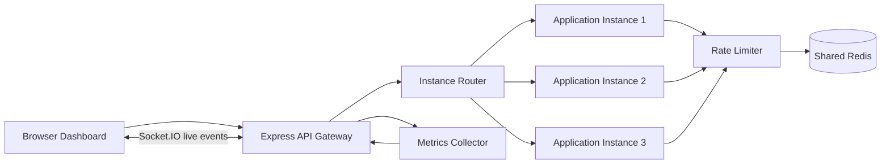

# Distributed Rate Limiting System

## 1. Project Overview

The Distributed Rate Limiting System is a web-based observability and experimentation platform for studying rate limiting across multiple application instances.

The system accepts requests from a traffic simulator or a manual request builder, applies a configurable rate-limit policy, records the decision, and displays live operational metrics. Redis stores the shared rate-limit state so that requests sent through different application instances still use one common quota.

This project is designed as a final-year CSE project demonstration. It focuses on understandable distributed-system concepts rather than unnecessary authentication, microservices, or deployment complexity.

## 2. Problem Statement

In a distributed API, multiple server instances may process requests for the same client. If every server keeps its own in-memory counter, a client can bypass the intended limit by sending requests to different instances.

The system solves this problem by storing rate-limit state in a shared Redis service and performing decisions atomically. Every application instance therefore observes and updates the same quota.

## 3. Objectives

- Implement distributed rate limiting using shared Redis state.
- Support Fixed Window, Sliding Window Counter, and Token Bucket algorithms.
- Demonstrate shared quotas across three application instances.
- Provide a configurable traffic simulator.
- Provide a manual request builder for individual and batch requests.
- Stream live request decisions and metrics using Socket.IO.
- Measure throughput, acceptance rate, rejection rate, average latency, P95 latency, and instance distribution.
- Provide a clear dashboard suitable for project evaluation and demonstrations.

## 4. Technology Stack

| Layer | Technology |
|---|---|
| Frontend | HTML5, CSS3, vanilla JavaScript |
| Charts | Chart.js |
| Backend | Node.js and Express |
| Protocol services | HTTP/REST, Socket.IO, gRPC, TCP, UDP |
| Shared state | Redis 7 |
| Redis client | ioredis |
| Real-time updates | Socket.IO |
| Containerization | Docker Compose |
| Testing | Node.js built-in test runner |

The frontend does not use React, Angular, Vue, or any other frontend framework.

## 5. System Architecture



The demonstration server contains one Express codebase with three logical application instances. Docker Compose runs the same application image three times with different ports and instance IDs. All instances connect to the same Redis service.

## 6. Main Modules

### Backend

- `server.js`
  - Express application setup.
  - REST endpoints.
  - Instance routing and fault simulation.
  - Traffic simulation lifecycle.
  - Socket.IO event broadcasting.

- `src/algorithms.js`
  - Atomic Redis Lua scripts.
  - Fixed Window decision logic.
  - Sliding Window Counter decision logic.
  - Token Bucket decision logic.

- `src/rateLimiter.js`
  - Common rate-limit decision interface.
  - HTTP status and retry-after calculation.

- `src/redis.js`
  - Shared Redis connection factory.
  - Redis connection error reporting.

- `src/metrics.js`
  - Actual request measurement storage.
  - Aggregate metrics.
  - Per-algorithm metrics.
  - Average and P95 latency calculation.

### Frontend

- `public/index.html`
  - Dashboard shell, navigation, Socket.IO and Chart.js loading.

- `public/app.js`
  - View rendering.
  - REST API calls.
  - Socket.IO event handling.
  - Traffic simulator controls.
  - Request builder.
  - Instance controls.
  - Live monitor filtering.
  - Report export.

- `public/policy-studio.js`
  - Algorithm selection cards.
  - Algorithm descriptions.
  - Selected algorithm metrics.
  - Measured comparison table.

- `public/styles.css`
  - Main responsive dark observability dashboard styling.

- `public/policy-studio.css`
  - Rate policy algorithm cards and comparison panel styling.

## 7. Rate-Limiting Algorithms

### Fixed Window

Counts requests in a fixed time interval.

Example: 100 requests per 60 seconds.

Advantages:

- Easy to understand.
- Low Redis storage overhead.
- Fast atomic increment operation.

Trade-off:

- Requests may burst around a window boundary.

### Sliding Window Counter

Combines the current and previous fixed windows using a time-weighted count.

Advantages:

- Smoother behavior near window boundaries.
- More resistant to boundary bursts.

Trade-off:

- Slightly more computation than Fixed Window.

### Token Bucket

Tokens refill continuously at a configured rate. Each request consumes one token.

Advantages:

- Supports controlled bursts.
- Models sustainable request rates naturally.

Trade-off:

- Requires token and timestamp state.
- Configuration is less intuitive for beginners.

## 8. Redis Consistency Design

Rate-limit keys use the following logical format:

```text
rl:<policy-id>:<identity>
```

The identity can be based on:

- API key
- Client IP metadata
- User ID
- Tenant ID

Client IP values entered in the UI are experiment metadata only. They are not trusted as actual network addresses.

Redis Lua scripts update counters and expiration values atomically. This prevents two application instances from making inconsistent decisions for the same identity at the same time.

## 9. REST API Summary

| Method | Endpoint | Purpose |
|---|---|---|
| `GET` | `/api/metrics/live` | Current measured metrics and instance status |
| `POST` | `/api/metrics/reset` | Clear current session measurements |
| `GET` | `/api/policies` | List active policies |
| `POST` | `/api/policies` | Save a policy and make it global |
| `POST` | `/api/traffic/single` | Process one manually configured request |
| `POST` | `/api/traffic/batch` | Process a request batch |
| `POST` | `/api/traffic/start` | Start a traffic simulation |
| `POST` | `/api/traffic/pause` | Pause a simulation |
| `POST` | `/api/traffic/resume` | Resume a simulation |
| `POST` | `/api/traffic/stop` | Stop a simulation |
| `GET` | `/api/requests` | Read recent request decisions |
| `GET` | `/api/instances` | Read instance status |
| `POST` | `/api/instances/:id/fault` | Simulate or recover an instance fault |
| `POST` | `/api/instances/:id/restart` | Restart an instance |
| `POST` | `/api/experiments` | Create a measured experiment record |
| `GET` | `/api/experiments/:id/report` | Read a numerical experiment report |

## 10. Socket.IO Events

| Event | Direction | Purpose |
|---|---|---|
| `metrics:update` | Server to browser | Live metrics, instances, policy, and recent events |
| `request:decision` | Server to browser | Individual request decision |
| `instances:update` | Server to browser | Instance health changes |
| `policy:update` | Server to browser | Active policy changes |
| `simulation:progress` | Server to browser | Simulation progress |
| `simulation:complete` | Server to browser | Final simulation result |
| `simulation:stopped` | Server to browser | Simulation stop notification |

## 11. Dashboard Screens

### Dashboard

Shows total requests, allowed requests, rejected requests, throughput, average latency, traffic chart, instance health, recent decisions, and active policy.

### Traffic Simulator

Allows configuration of total requests, requests per second, virtual clients, and traffic pattern. Supported patterns are Constant, Burst, and Gradually Increasing.

### Request Builder

Allows manual configuration of client metadata, identity type, API key, user ID, tenant ID, protocol, HTTP method, and endpoint. It displays the actual target instance, protocol, and rate-limit decision.

The builder can send a request over HTTP/REST or Socket.IO directly. For gRPC, TCP, and UDP, the browser sends the test input to a local adapter, which forwards it over the selected native protocol to a protocol listener. Each listener invokes the same rate limiter and shared Redis state. TCP uses newline-delimited JSON, UDP uses one JSON datagram per request, and gRPC uses the service in `proto/rate_limiter.proto`. The three Docker instances publish these listeners on ports 4001–4003 (TCP), 5001–5003 (UDP), and 6001–6003 (gRPC).

These protocol listeners are intended for local demonstrations. The gRPC service uses insecure credentials, and the TCP/UDP test framing has no authentication or encryption; do not expose these ports to untrusted networks.

### Rate Policy

Provides the algorithm cards, active policy settings, selected-algorithm metrics, and a measured comparison table.

### Server Instances

Shows three instances with health status, request count, and latency. An instance can be faulted or restarted.

### Live Request Monitor

Displays request timestamp, request ID, identity, target instance, endpoint, algorithm, decision, status, and latency. Results can be filtered by allowed or rejected decisions.

### Experiment Reports

Shows measured totals, acceptance and rejection percentages, throughput, P95 latency, instance distribution, and CSV export.

## 12. Installation and Execution

### Requirements

- Windows 10/11.
- Docker Desktop running.
- Node.js 18 or newer for local development and tests.

### Docker execution

From the project folder:

```powershell
.\start.ps1
```

Open:

```text
http://localhost:3001
```

Stop the stack:

```powershell
.\stop.ps1
```

The same commands are available through `start.bat` and `stop.bat`.

### Local development

Install packages:

```powershell
npm install
```

Start Redis:

```powershell
docker compose up redis -d
```

Start the Node.js application:

```powershell
npm start
```

Open `http://localhost:3000`.

## 13. Demonstration Procedure

1. Start Docker with `start.ps1`.
2. Open the Dashboard and confirm the live connection indicator.
3. Open Rate Policy and select Fixed Window.
4. Set 100 requests per 60 seconds with API key scope.
5. Save the active policy.
6. Open Traffic Simulator.
7. Configure 150 requests, 25 requests/sec, and one virtual client.
8. Start the simulation.
9. Observe approximately 100 allowed and 50 rejected requests, depending on timing and the current Redis window.
10. Open Rate Policy and inspect the selected algorithm metrics.
11. Select Token Bucket, set capacity to 10 and refill rate to 2 requests/sec, save it, and run a burst workload.
12. Compare Token Bucket and Fixed Window in the measured comparison table.
13. Open Instances and simulate a fault on one instance.
14. Send more requests and confirm processing continues through healthy instances.
15. Open Live Monitor to inspect target instances and decisions.
16. Open Reports and export the measurements as CSV.

## 14. Testing

Run:

```powershell
npm test
```

The tests cover:

- Fixed Window rejection after the configured limit.
- Shared quota enforcement across concurrent logical instances.
- Token Bucket rejection after bucket exhaustion.

The tests require Redis to be running on `localhost:6379`.

## 15. Limitations and Future Improvements

- Authentication and authorization are intentionally outside the project scope.
- Metrics are stored in the application process for demonstration purposes.
- Experiment persistence can be extended with SQLite or PostgreSQL.
- Production deployments would use a dedicated load balancer and external monitoring system.
- Redis high availability and authentication should be configured before production use.
- Automated browser tests could be added using Playwright.

## 16. Academic Summary

This project demonstrates distributed state management, atomic operations, rate-limiting algorithms, REST API design, real-time event streaming, workload simulation, fault handling, and performance measurement in one manageable application. Its main technical contribution is showing that a shared Redis state is required for consistent rate limiting when multiple application instances process requests for the same client.
